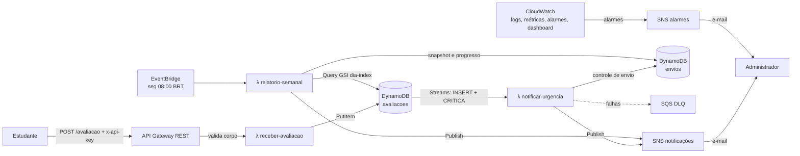

# NotaCampus — Plataforma de Feedback de Aulas

Tech Challenge Fase 4. Aplicação **serverless em Java 21** hospedada na **AWS** que recebe avaliações
de aulas, avisa o administrador sobre feedbacks críticos e envia um relatório semanal com a média das
avaliações.

| Ambiente AWS | |
|---|---|
| Account ID | `317599963509` |
| ARN da conta | `arn:aws:account::317599963509:account` |
| Região | **América do Sul (São Paulo) — `sa-east-1`** |
| Stack CloudFormation | `notacampus` |

## 1. Modelo de cloud escolhido

| Decisão | Escolha | Justificativa |
|---|---|---|
| Provedor / modelo de implantação | **Nuvem pública — AWS** | Serviços gerenciados e custo por uso, adequado a créditos limitados. |
| Modelo de serviço | **FaaS (AWS Lambda) + serviços gerenciados (PaaS)** | Sem servidores para administrar; escala a zero. |
| Linguagem / runtime | **Java 21** (`java21`, arm64) | 100% Java, Maven, testes JUnit. |
| Infraestrutura como código | **AWS SAM (CloudFormation)** | Ambiente versionado e reproduzível com `sam deploy`. |
| CI/CD | **GitHub Actions + OIDC** | Deploy automatizado sem chaves de longa duração. |

## 2. Arquitetura



### Componentes e responsabilidades (Responsabilidade Única)

| Componente | Responsabilidade |
|---|---|
| **λ `receber-avaliacao`** | Somente receber, validar, classificar urgência e **persistir** a avaliação. |
| **λ `notificar-urgencia`** | Somente **notificar** o administrador sobre avaliações críticas. |
| **λ `relatorio-semanal`** | Somente **consolidar e enviar** o relatório semanal. |
| **API Gateway** | Entrada HTTP, API key, throttling e validação de schema. |
| **DynamoDB** | Persistência (on-demand, criptografado, PITR) + Streams + GSI por dia. |
| **DynamoDB `envios`** | Reservas condicionais, conteúdo dos envios e progresso por parte para controlar duplicidades. |
| **SNS** | Entrega de e-mails ao administrador (urgências, relatório e alarmes). |
| **EventBridge** | Agendamento semanal do relatório. |
| **SQS (DLQ)** | Guarda notificações críticas que não puderam ser entregues. |
| **CloudWatch** | Logs, métricas, alarmes e dashboard. |

`receber-avaliacao` **não conhece** a notificação: o DynamoDB Streams aciona `notificar-urgencia`
com filtro de evento (apenas `INSERT` com `urgencia = CRITICA`), então a função só roda quando necessário.

### Regra de urgência

| Nota | Urgência |
|---|---|
| 0 a 3 | `CRITICA` |
| 4 a 6 | `BAIXA` |
| 7 a 10 | `MEDIA` |

Implementada em `functions/receber-avaliacao/.../Urgencia.java` (e coberta por `UrgenciaTest`).

## 3. Estrutura do repositório

```
├── pom.xml                         # Agregador Maven (mvn -B test roda tudo)
├── template.yaml                   # Infraestrutura (SAM)
├── samconfig.toml
├── functions/
│   ├── receber-avaliacao/          # Projeto Maven independente (pacote br.com.notacampus.receber)
│   ├── notificar-urgencia/         # idem (pacote br.com.notacampus.notificar)
│   └── relatorio-semanal/          # idem (pacote br.com.notacampus.relatorio)
├── events/relatorio-evento.json    # Evento de exemplo para o relatório
├── docs/
│   ├── passo-a-passo-aws.md        # Configuração completa na AWS
│   └── roteiro-video.md            # Roteiro da demonstração
└── .github/workflows/deploy.yml    # CI/CD
```

Cada função segue a mesma organização em camadas:

| Camada | Exemplo | Depende de AWS? |
|---|---|---|
| **Handler** (adaptador de entrada) | `ReceberAvaliacaoHandler` | Sim (tipos de evento do Lambda) |
| **Serviço** (regra de negócio) | `ReceberAvaliacaoService` | Não |
| **Porta + adaptador de saída** | `AvaliacaoRepository` → `DynamoAvaliacaoRepository` | Somente o adaptador |

Isso permite testar toda a regra de negócio com JUnit, sem AWS. Cada função é um projeto Maven
independente porque o `sam build` empacota cada diretório de forma isolada; por isso classes
como `SnsNotificador`, `Assunto`, `RegistroEnvios`, `EnvioIdempotente` e `DynamoRegistroEnvios` existem
em mais de uma função. O controle de envio tem a mesma implementação nos dois módulos e deve ser
mantido e validado em ambos.

## 4. Instruções de deploy

Passo a passo completo (conta, credenciais, OIDC, permissões): [`docs/passo-a-passo-aws.md`](docs/passo-a-passo-aws.md).

### Pré-requisitos
- Conta AWS e [AWS CLI](https://docs.aws.amazon.com/cli/) configurado (região `sa-east-1`)
- [AWS SAM CLI](https://docs.aws.amazon.com/serverless-application-model/latest/developerguide/install-sam-cli.html)
- **JDK 21** e **Apache Maven 3.9+**

### Deploy manual

```bash
mvn -B test                                  # testes JUnit das 3 funções
sam validate --lint                          # valida o template
sam build                                    # compila as funções com Maven
sam deploy --parameter-overrides AdminEmail=seu-email@exemplo.com
```

1. **Confirme as assinaturas**: a AWS envia 2 e-mails (notificações e alarmes). Clique em
   *Confirm subscription* em ambos — sem isso nenhum e-mail é entregue.
2. Ao final, o `sam deploy` exibe os *Outputs* (`ApiUrl`, `ApiKeyId`, `Dashboard`...).
3. Recupere o valor da API key:

```bash
aws apigateway get-api-key --api-key <ApiKeyId> --include-value --query value --output text --region sa-east-1
```

### Deploy automatizado (GitHub Actions)

O workflow `.github/workflows/deploy.yml` roda `mvn test` e `sam validate --lint` em todo push/PR e
faz o **deploy automático** em push na `main`.

1. Crie na AWS um provedor OIDC para `token.actions.githubusercontent.com` e a role
   `github-deploy-notacampus` (ARN: `arn:aws:iam::317599963509:role/github-deploy-notacampus`), com
   *trust policy* restrita ao repositório e ao environment do job de deploy
   (`repo:<org>/<repo>:environment:producao`). Políticas completas em
   [`docs/passo-a-passo-aws.md`](docs/passo-a-passo-aws.md).
2. No GitHub, em *Settings → Secrets and variables → Actions*, crie:
   - Secret `AWS_DEPLOY_ROLE_ARN` — ARN da role
   - Secret `ADMIN_EMAIL` — e-mail do administrador
   - Variable `AWS_REGION` (opcional; padrão `sa-east-1`)
3. Crie o *Environment* `producao` (opcionalmente com aprovação manual).

> **AWS Academy / Learner Lab:** esses ambientes costumam bloquear a criação de roles IAM. Se for
> o seu caso, o template precisará de ajustes (usar a `LabRole` existente).

### Remover o ambiente

```bash
sam delete
```
As tabelas DynamoDB usam `DeletionPolicy: Retain` (proteção dos dados) e **permanecem** após o
`sam delete`. A tabela `envios` preserva também os comprovantes de envio e os textos dos relatórios;
sua remoção permite que eventos antigos sejam enviados novamente.

## 5. Como usar / testar

```bash
API_URL="<ApiUrl do output>"
API_KEY="<valor da api key>"

# Avaliação crítica (dispara e-mail de urgência)
curl -X POST "$API_URL" -H "Content-Type: application/json" -H "x-api-key: $API_KEY" \
     -d '{"descricao": "O áudio da aula estava inaudível", "nota": 1}'

# Avaliação alta
curl -X POST "$API_URL" -H "Content-Type: application/json" -H "x-api-key: $API_KEY" \
     -d '{"descricao": "Aula excelente!", "nota": 9}'
```

Resposta (`201`):
```json
{"id": "9b2f...", "urgencia": "CRITICA", "dataEnvio": "2026-11-15T23:50:12Z"}
```

Gerar o relatório sob demanda (útil na demonstração):
```bash
aws lambda invoke --function-name notacampus-relatorio-semanal --region sa-east-1 \
    --cli-binary-format raw-in-base64-out \
    --payload "{\"data_fim\": \"$(date +%F)\", \"dias\": 7}" /dev/stdout
```

> O path usa `/avaliacao` (sem acento) para evitar problemas de codificação em URLs.

## 6. Documentação das funções

### `receber-avaliacao`
| | |
|---|---|
| Handler | `br.com.notacampus.receber.ReceberAvaliacaoHandler::handleRequest` |
| Gatilho | `POST /avaliacao` (API Gateway REST, API key obrigatória) |
| Entrada | `{"descricao": string (1–1000), "nota": int (0–10)}` |
| Saída | `201 {id, urgencia, dataEnvio}` · `400 {erro}` · `500 {erro}` |
| Persistência | Item no DynamoDB: `id`, `descricao`, `nota`, `urgencia`, `dataEnvio` (UTC), `dia` (data em America/Sao_Paulo) |
| Variável de ambiente | `TABLE_NAME` |
| Permissões IAM | `dynamodb:PutItem` apenas na tabela |
| Validação | Dupla: schema no API Gateway **e** `AvaliacaoValidator` no código |

### `notificar-urgencia`
| | |
|---|---|
| Handler | `br.com.notacampus.notificar.NotificarUrgenciaHandler::handleRequest` |
| Gatilho | DynamoDB Streams, filtrado: `INSERT` + `urgencia = CRITICA` |
| Ação | Publica e-mail no SNS com **Descrição**, **Urgência** e **Data de envio** |
| Resiliência | Retentativas do Stream até a idade máxima de 1 hora, *bisect batch*, falhas parciais (`batchItemFailures`) e destino de falha SQS |
| Idempotência | Chave `URGENCIA#<id da avaliação>`; alertas confirmados não são publicados novamente pela aplicação |
| Variáveis de ambiente | `TOPIC_ARN`, `ENVIOS_TABLE_NAME` |
| Permissões IAM | `sns:Publish` no tópico; `sqs:SendMessage` na DLQ; `GetItem`/`PutItem`/`UpdateItem` na tabela de envios, apenas para chaves `URGENCIA#*`; `kms:GenerateDataKey*` e `kms:Decrypt` na chave `alias/aws/sns`, somente via SNS para este tópico |

### `relatorio-semanal`
| | |
|---|---|
| Handler | `br.com.notacampus.relatorio.RelatorioSemanalHandler::handleRequest` |
| Gatilho | EventBridge `cron(0 11 ? * MON *)` — segundas, 08:00 BRT |
| Período | 7 dias completos anteriores à execução (parametrizável via evento: `data_fim`, `dias`) |
| Conteúdo | Média das avaliações, total, quantidade **por dia**, quantidade **por urgência** e **todos** os feedbacks com descrição completa, urgência e data de envio |
| Entrega | E-mail via SNS; relatórios grandes são divididos em partes numeradas no assunto, com até 240 KiB de texto UTF-8 por mensagem. O resumo aparece na primeira parte e os detalhes continuam nas demais, sem cortes de conteúdo. |
| Acesso a dados | `Query` paginada no GSI `dia-index` (sem `Scan`) |
| Idempotência | Chave `RELATORIO#<início>#<fim>`; conteúdo e resumo persistidos antes de publicar, com confirmação de cada parte e retomada das pendentes |
| Variáveis de ambiente | `TABLE_NAME`, `INDEX_NAME`, `TOPIC_ARN`, `ENVIOS_TABLE_NAME` |
| Permissões IAM | `dynamodb:Query` (tabela + índice); `sns:Publish`; `GetItem`/`PutItem`/`UpdateItem` na tabela de envios, apenas para chaves `RELATORIO#*`; `kms:GenerateDataKey*` e `kms:Decrypt` na chave `alias/aws/sns`, somente via SNS para este tópico |

> Os assuntos dos e-mails são normalizados para ASCII (`Assunto.sanitizar`), pois o SNS restringe o campo *Subject*.

O relatório preserva as descrições armazenadas, incluindo acentos, emojis e quebras de linha. Para
respeitar o limite de 256 KiB do SNS com assinaturas de e-mail, a divisão prefere finais de linha e
mantém os caracteres Unicode inteiros. Leia as partes pela numeração do assunto; a ordem de chegada
dos e-mails pode variar. [Limites de publicação do SNS](https://docs.aws.amazon.com/sns/latest/api/API_Publish.html).

### Controle de duplicidades e retomada

A tabela privada `${stack}-envios` guarda o estado de cada trabalho (`PROCESSANDO` ou `ENVIADO`),
seu proprietário, o vencimento da reserva, o conteúdo e a próxima parte a enviar. Atualizações
condicionais permitem apenas um proprietário ativo. As reservas duram 180 segundos, acima do
timeout máximo de 120 segundos das funções; após uma interrupção, outra execução pode assumir o
trabalho. Falhas capturadas liberam a reserva imediatamente. Indisponibilidade da tabela impede a
publicação, para não enviar sem controle persistente.

O relatório é preparado uma única vez por intervalo: retentativas reutilizam o mesmo conteúdo,
mesmo se surgirem novos dados. Partes já confirmadas são ignoradas. O campo `time` do EventBridge
fixa a data de referência entre retentativas; para repetir uma chamada manual, informe o mesmo
`data_fim` e `dias`. Uma nova solicitação para um intervalo concluído retorna os totais salvos e
não gera outro e-mail. Não há expiração automática dos comprovantes; mantenha a tabela para
preservar a deduplicação.

O aceite do SNS e a confirmação no DynamoDB são operações separadas: se o SNS aceitar a mensagem
e a função perder a resposta ou falhar antes de confirmar a parte, ela poderá ser reenviada. O SNS
Standard também pode entregar cópias ao destinatário. Portanto, o controle evita reenvios já
confirmados e concorrência na aplicação, mas não garante entrega única de e-mail em toda situação.
[Comportamento de entrega do SNS](https://aws.amazon.com/sns/faqs/).

Os testes unitários rodam com `mvn -B test`. Para validar também as operações condicionais reais,
inicie um DynamoDB Local e rode:

```bash
mvn -B -Dnotacampus.dynamodb.endpoint=http://127.0.0.1:8013 test
```

Esses testes criam e removem tabelas temporárias apenas em um endpoint de loopback; sem a propriedade,
as classes de integração são ignoradas. Cobrem concorrência, expiração, snapshots e retomada parcial.

## 7. Monitoramento e alertas

| Recurso | Descrição |
|---|---|
| **CloudWatch Logs** | Logs com retenção configurável (padrão 30 dias). A descrição do feedback **não** é logada. |
| **Alarmes** | Erros em cada uma das 3 funções · 5XX no API Gateway · mensagens na DLQ |
| **Notificação de alarmes** | Alarmes → SNS `alarmes` → e-mail do administrador |
| **Dashboard** | `notacampus-dashboard`: invocações, erros, requisições/4XX/5XX, latência e DLQ |
| **X-Ray** | Tracing ativo nas funções e no API Gateway |
| **Métricas do API Gateway** | Habilitadas (`MetricsEnabled`) |

## 8. Segurança e governança de acesso

- **Menor privilégio:** cada função tem sua própria role IAM, restrita a ações e recursos específicos.
- **Autenticação da API:** API key obrigatória + *usage plan* (10 req/s, burst 20, 10.000/dia).
- **Validação de entrada:** JSON Schema no API Gateway + validação no código (rejeita booleano, texto em `nota`, decimais etc.).
- **Dados em repouso:** DynamoDB com criptografia (SSE), SQS com SSE, SNS de notificações com KMS (`alias/aws/sns`).
- **Uso da chave KMS:** as funções de notificação e relatório podem gerar e decifrar chaves de dados apenas com `alias/aws/sns` da conta e região do deploy, via SNS e com o contexto do tópico de notificações. O alias é restringido por `kms:ResourceAliases`, pois operações criptográficas exigem ARN de chave no campo `Resource`. [Referência AWS](https://docs.aws.amazon.com/sns/latest/dg/sns-key-management.html).
- **Dados em trânsito:** HTTPS obrigatório no API Gateway.
- **Proteção de dados:** *Point-in-Time Recovery* no DynamoDB; tabela com `DeletionPolicy: Retain`.
- **Privacidade:** conteúdo dos feedbacks fora dos logs; mensagens de erro genéricas ao cliente.
- **CI/CD sem segredos de longa duração:** OIDC com role assumida por repositório/environment.
- **Rastreabilidade:** infraestrutura como código versionado; mudanças passam por PR + testes.

### Limitações conhecidas / próximos passos
- O tópico de alarmes não usa KMS gerenciado (o CloudWatch não consegue publicar em tópicos com `aws/sns`); use uma chave KMS própria para cifrá-lo.
- Para exposição pública real, considerar AWS WAF e Cognito/autorizador no lugar da API key.
- Cold start de Java: mitigado com `TieredStopAtLevel=1`; para reduzir mais, habilitar Lambda SnapStart.
- E-mails via SNS são texto simples; para HTML/anexos, trocar por Amazon SES.

## 9. Custos

Todos os serviços são *pay-per-use* (Lambda, API Gateway, DynamoDB on-demand, SNS, SQS, EventBridge).
Para o volume de uma demonstração, o custo fica dentro da camada gratuita da AWS (alarmes
CloudWatch além de 10 e dashboards além de 3 são cobrados).
